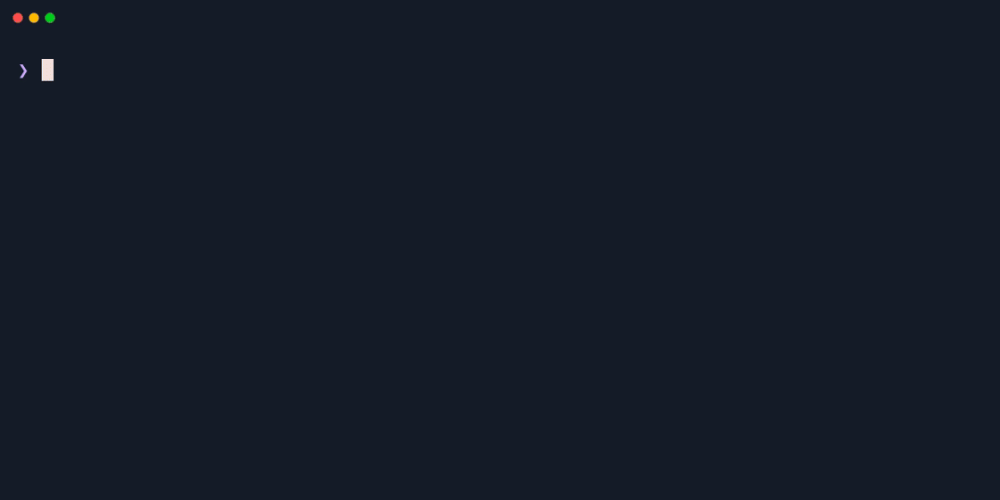

**Full-stack engineer on high-traffic platforms.** 
Linux drivers · self-hosted infrastructure · reverse-engineering

 

📍 Vancouver, Canada &nbsp;·&nbsp; 🏢 [@tradablebits](https://github.com/tradablebits)

 

  

### 💬 Get in touch

Happy to talk about scaling web platforms, kernel-space debugging, or homelab overengineering.

**[tristanbalon.com](https://tristanbalon.com)** &nbsp;·&nbsp; **[LinkedIn](https://linkedin.com/in/tristan-balon)** &nbsp;·&nbsp; **[tristan.balon@outlook.com](mailto:tristan.balon@outlook.com)**

<i>Thanks for stopping by ✨</i>

 

## 🛠️ Tech

  
  **Languages**
  
  
  
  **Frameworks & Data**
  
  
  
  **Infrastructure & Cloud**
  
  

